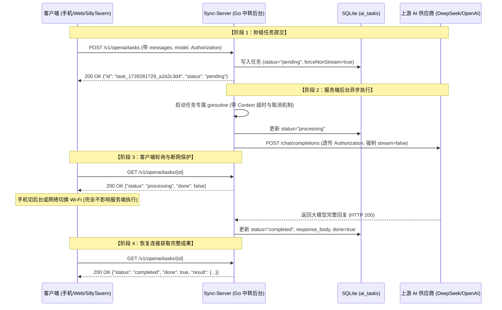

# 功能说明：AI 接口后台任务中转服务 (AI Task Relay)

> **版本**：v1.0.0 (任务异步化、24h 滚动归档、防断网防切后台版)  
> **编写者**：码场老司机“小鸡”  
> **适用对象**：后续接手二开、运维部署与前端架构审查的开发人员  
> **核心痛点**：长回复/长思考（o1/o3/DeepSeek R1/Claude 3.7）动辄耗时几分钟，手机切后台、网络抖动、切换 Wi-Fi 会导致长连接直接断开，整个回复前功尽弃全部作废。  
> **设计原理**：请求任务化 (Submit-and-Poll)、默认非流式稳定转向上游、24 小时自动物理清理、容量上限自动淘汰 (FIFO)、100% 兼容 CatieCli 与标准 `/v1/chat/completions`。

---

## 目录
1. [功能全貌与解决的核心痛点](#1-功能全貌与解决的核心痛点)
2. [后台任务 API 规范与协议流转](#2-后台任务-api-规范与协议流转)
3. [服务端配置参数与热重载支持](#3-服务端配置参数与热重载支持)
4. [生命周期管理：24 小时 TTL 与 500 条上限裁剪](#4-生命周期管理24-小时-ttl-与-500-条上限裁剪)
5. [前端接入方式与客户端兼容方案](#5-前端接入方式与客户端兼容方案)
6. [架构设计与代码职责分配](#6-架构设计与代码职责分配)
7. [避坑指南与安全红线](#7-避坑指南与安全红线)

---

## 1. 功能全貌与解决的核心痛点

### 1.1 传统直连长连接的核心缺陷
在现今大模型交互中，长文本生成与深度思考（Thinking）模型的请求耗时显著拉长（常见持续 60 秒至 5 分钟）：
- **移动端息屏/切后台**：iOS Safari、Android Chrome 或微信内置浏览器在用户切到其他应用或屏幕变暗锁定后，操作系统的电源管理机制会在几秒内掐断或挂起 WebSocket / HTTP SSE 长连接；
- **网络抖动与基站切换**：手机进电梯、地下车库、由 Wi-Fi 自动跳至 5G 时，底层 TCP 连接被 RST 重置；
- **整个回复作废**：传统流式请求一旦中断，前端无法断点续接，已经生成了上千字的内容直接丢失报错，既浪费用户时间，又白白消耗上游 API 额度。

### 1.2 后台任务化 (Task Relay) 的解决方案
系统将长连接的单向挂起请求转化为**“任务异步化（提交 ➔ 轮询）”**模式：
1. **客户端秒级提交**：客户端向 `POST /v1/openai/tasks` 发起请求，服务端校验入库后**立即返回任务 ID**（响应时间 < 50ms）；
2. **服务端后台接力**：服务端独立在后台调用上游 AI 接口（如 DeepSeek、OpenAI、SiliconFlow 或反代），生成不受客户端网络与手机状态影响；
3. **支持断网自愈与轮询重连**：客户端通过 `GET /v1/openai/tasks/{id}` 定时查询任务进度。即使客户端断网 10 分钟，网络恢复后依然能凭任务 ID 查到完整的生成结果；
4. **默认非流式输出保障**：开启中转时，默认以非流式与上游交互，最大程度降低网络开销与缓冲负担；
5. **增量分片续传**：若开启流式暂存，支持 `?after=N` 参数实现断点续传。

---

## 2. 后台任务 API 规范与协议流转

### 2.1 整体时序流程图



---

### 2.2 核心接口定义

#### 1. 提交异步任务
- **路径**：`POST /v1/openai/tasks`（同时兼容别名 `POST /api/ai/tasks`）
- **请求头**：
  - `Content-Type: application/json`
  - `Authorization: Bearer <API-KEY>`（原样透传至上游 AI 平台）
  - `X-Target-Url` 或 `X-Upstream-Url`（可选）：动态指定目标上游地址。未传时自动使用 `config.json` 中的 `defaultUpstream`。
  - `X-Api-Key`（可选）：若未在 `Authorization` 中传 Bearer，可在此传入。
- **请求体**：与 OpenAI 标准 `/v1/chat/completions` **100% 完全一致**：
  ```json
  {
    "model": "deepseek-chat",
    "messages": [
      { "role": "system", "content": "你是一个资深全栈架构师" },
      { "role": "user", "content": "请分析 React 和 Vue3 的响应式原理差异" }
    ],
    "temperature": 0.7,
    "stream": false
  }
  ```
- **秒级成功响应** (`HTTP 200`):
  ```json
  {
    "id": "task_1739281729_ce81f9a2",
    "task_id": "task_1739281729_ce81f9a2",
    "status": "pending",
    "created_at": 1739281729
  }
  ```
  *(注：同时返回 `id` 与 `task_id`，以 100% 兼容 CatieCli / `st-catiecli-tasks` 等各种客户端生态)*

#### 2. 轮询查询任务进度与结果
- **路径**：`GET /v1/openai/tasks/{id}`（支持 `?after=N` 分片增量索引）
- **响应体** (`HTTP 200`):
  - **进行中** (`status="processing", done=false`):
    ```json
    {
      "id": "task_1739281729_ce81f9a2",
      "task_id": "task_1739281729_ce81f9a2",
      "status": "processing",
      "status_code": 200,
      "done": false,
      "chunks": [],
      "next_after": 0,
      "created_at": 1739281729
    }
    ```
  - **已成功完成** (`status="completed", done=true`):
    ```json
    {
      "id": "task_1739281729_ce81f9a2",
      "task_id": "task_1739281729_ce81f9a2",
      "status": "completed",
      "status_code": 200,
      "done": true,
      "chunks": ["data: ...\n\n", "data: [DONE]\n\n"],
      "next_after": 2,
      "result": {
        "id": "chatcmpl-7890",
        "object": "chat.completion",
        "created": 1739281735,
        "model": "deepseek-chat",
        "choices": [
          {
            "index": 0,
            "message": {
              "role": "assistant",
              "content": "React 采用显式不可变数据流与 Virtual DOM Diff..."
            },
            "finish_reason": "stop"
          }
        ],
        "usage": {
          "prompt_tokens": 30,
          "completion_tokens": 120,
          "total_tokens": 150
        }
      },
      "created_at": 1739281729,
      "updated_at": 1739281735
    }
    ```
    *(注：即便开启了 `forceNonStream: true`，服务端也会从完整响应体中自动合成标准的 SSE `chunks` 与 `[DONE]`，彻底避免 SillyTavern 等流式客户端因收到空分片而内容蒸发)*
  - **执行失败** (`status="failed", done=true`):
    ```json
    {
      "id": "task_1739281729_ce81f9a2",
      "task_id": "task_1739281729_ce81f9a2",
      "status": "failed",
      "status_code": 429,
      "done": true,
      "error": "Rate limit exceeded: 5 requests per minute",
      "result": {
        "error": { "message": "Rate limit exceeded: 5 requests per minute", "type": "requests" }
      },
      "created_at": 1739281729
    }
    ```

#### 3. 主动取消任务
- **路径**：`POST /v1/openai/tasks/{id}/cancel`
- **响应体** (`HTTP 200`):
  ```json
  {
    "id": "task_1739281729_ce81f9a2",
    "task_id": "task_1739281729_ce81f9a2",
    "status": "cancelled"
  }
  ```

#### 4. 标准直接中转接口 (无需插件)
- **路径**：`POST /v1/chat/completions`（同时兼容 `/api/ai/chat/completions`）
- **功能**：面向未安装 CatieCli 插件的原生 OpenAI 客户端（包括各类 Web UI、命令行工具等），提供与标准接口完全兼容的直连中转能力。在服务端后台同样自动任务化持久存储，同时客户端请求 `stream: true` 时自动回传实时/合成 SSE，`stream: false` 时直接回传完整 JSON。

#### 5. 任务列表与手动清理
- **路径**：`GET /v1/openai/tasks?limit=50&status=completed`
- **物理删除**：`DELETE /v1/openai/tasks/{id}`

---

## 3. 服务端配置参数与热重载支持

在 `sync-server/config.json` 中，通过 `aiRelay` 配置块进行控制：

```json
{
  "listen": "0.0.0.0:8443",
  "dataDir": "./data",
  "allowedOrigins": ["*"],
  "aiRelay": {
    "enabled": false,
    "defaultUpstream": "https://api.openai.com/v1",
    "maxTasks": 500,
    "ttlHours": 24,
    "forceNonStream": true,
    "timeoutMinutes": 30
  }
}
```

### 字段说明表
| 字段名 | 默认值 | 作用说明 | 热重载支持 |
|---|---|---|---|
| `enabled` | `false` | 总开关。为 `false` 时请求返回 403 `relay_disabled`，保证默认安全不误开 | **支持动态热切换** |
| `defaultUpstream` | `"https://api.openai.com/v1"` | 默认上游基准地址。客户端未在 Header 中传入 `X-Target-Url` 时回退使用此地址 | **支持动态热切换** |
| `maxTasks` | `500` | 最多保存的任务总数量上限。超限时按 FIFO 规则物理淘汰最老的历史任务 | **支持动态热切换** |
| `ttlHours` | `24` | 任务数据落盘保留时长（小时）。超出该期限的任务自动清理释放空间 | **支持动态热切换** |
| `forceNonStream` | `true` | **是否强制/默认非流式转向上游**。开启后即便客户端传 `stream: true` 也会改发为 `stream: false` | **支持动态热切换** |
| `timeoutMinutes` | `30` | 单个后台任务上游调用的最长等待超时（分钟）。超时自动中断上游请求并置为 504 | **支持动态热切换** |

> **提示**：修改 `config.json` 并保存后，服务内置的 `ConfigWatcher` 会在 1 分钟内自动感知并热更新生效，**完全无需重启 sync-server**。

---

## 4. 生命周期管理：24 小时 TTL 与 500 条上限裁剪

为了杜绝大模型长回复长期霸占服务器 SQLite 磁盘空间，系统设立了双重防爆机制：

### 4.1 24 小时 TTL 自动到期物理销毁 (`CleanExpiredTasks`)
- 每条任务写入时，数据库计算并持久化 `expires_at = now + ttlHours * 3600`；
- 后台常驻定时器（每 5 分钟执行一次，以及服务启动时自检）：
  ```sql
  DELETE FROM ai_tasks WHERE expires_at < ?;
  ```
- 过期记录将被物理清除，彻底杜绝数据堆积。

### 4.2 500 条最大配额先进先出裁剪 (`pruneExcessTasks`)
- 当任务总数达到或超过 `maxTasks`（默认 500 条）时，系统自动执行**仅针对终态任务（已完成/失败/已取消）**的先进先出淘汰：
  ```sql
  DELETE FROM ai_tasks WHERE id IN (
      SELECT id FROM ai_tasks
      WHERE status IN ('completed', 'failed', 'cancelled')
      ORDER BY created_at ASC LIMIT ?
  );
  ```
- **核心安全保障**：严格保护当前正在后台执行中的长任务（`status='processing'` 或 `pending`），防止高并发时活跃中的长思考请求被误杀淘汰。

### 4.3 异常断电与服务重启自动恢复 (`recoverStaleTasks`)
- 若服务器遭遇断电、强制 kill 或崩溃重启，先前处于 `pending` 或 `processing` 的死锁孤儿任务将在服务启动阶段被自动检出并安全转为 `cancelled` 终态，并输出自愈日志，彻底防止前端客户端永久死等。

---

## 5. 前端接入方式与客户端兼容方案

### 方案 A：在 SillyTavern（酒馆）中通过 `st-catiecli-tasks` 插件使用
1. 在酒馆扩展面板安装 `https://github.com/su-kaka/st-catiecli-tasks`；
2. API 选择 `Custom (OpenAI-compatible)`，端点填入你的 `http://你的IP:8443`；
3. 填入上游 API Key 即可，无需对酒馆做任何额外魔改。

### 方案 B：在 `ruthless-ai-assistant`（摸鱼助手前端）中作为中转端点
在网页端【系统设置 ➔ API 端点设置】中新增端点：
- **名称**：防掉线中转 (Sync-Server Relay)
- **API URL**：`http://127.0.0.1:8443/v1`（或公网地址）
- **自定义请求头**：
  - `X-Target-Url: https://api.deepseek.com/v1`（指定目标大模型供应商）
- **API 密钥**：填写目标供应商的实际密钥（如 DeepSeek `sk-xxx`）
- **流式输出**：关闭（与服务端默认非流式对齐）

---

## 6. 架构设计与代码职责分配

为了遵守架构师代码规范中的“控大防膨与优先独立文件封装”原则，本次改动全部隔离封装：

| 文件路径 | 职责范围 |
|---|---|
| `sync-server/internal/relay/types.go` | 数据结构与交互协议定义（`Task`、`TaskStatusResponse`、状态机枚举） |
| `sync-server/internal/relay/manager.go` | **核心业务引擎**。负责任务入库排队、后台异步调用上游、超时控制、任务取消、24h TTL 清理与 500 条上限淘汰 |
| `sync-server/internal/relay/handler.go` | **HTTP 控制层**。统一处理 `/v1/openai/tasks` 各路由输入解析、10MB 体积拦截、CORS 响应与错误输出 |
| `sync-server/internal/relay/relay_test.go` | **单元测试套件**。覆盖提交、验证、超时、报错、取消、24h 过期与 500 条淘汰全路径（8 项测试全 PASS） |
| `sync-server/internal/httpapi/routes.go` | 路由装配器。将 `/v1/openai/tasks` 与 `/api/ai/tasks` 注册至主 HTTP Mux 并打通热重载监听 |
| `sync-server/internal/httpapi/middleware.go` | 跨域中间件。在 `Access-Control-Allow-Headers` 中放行 `X-Target-Url`、`X-Upstream-Url`、`X-Api-Key` 等定制头 |

---

## 7. 避坑指南与安全红线

1. **防滥用与默认关闭**：
   - `config.json` 中默认 `aiRelay.enabled = false`。若面向公网提供服务，请配合 `X-Real-IP` 限流，或通过上游 API Key 的额度限制控制用量。
2. **Context 超时必须与 HTTP Client 解耦**：
   - 严禁在全局 `http.Client` 设置固定超时（如 30 秒），这会导致深度思考大模型在中途被直接掐断。必须使用每个任务独立的 `context.WithTimeout`。
3. **安全路径与 SQL 注入防范**：
   - 任务 ID 由服务端统一签发 `task_时间戳_随机串`，严禁相信前端传入的任务 ID 格式；查询一律采用参数化 SQL。
4. **CORS 预检支持**：
   - 客户端发往 `/v1/openai/tasks` 会附带多种自定义请求头（`X-Target-Url`、`X-Sync-Token` 等），服务端必须在 `OPTIONS` 预检中完整放行并返回 `204 No Content`。
5. **自动记忆总结的中转闭环与决策状态流转**：
   - 任务终态（实时完成或离线自愈）必须触发 `checkAndTriggerAutoSummary`；
   - 开启中转达阈值时弹出专属决策模态框（支持云端总结、本地直连、稍后提醒与记住偏好）；
   - 未连云端时强制置灰保护；重新开启云端中转时自动感知环境突变并唤醒策略至“每次询问”。
   - 浏览器跨域调用带有自定义头（`X-Target-Url`）的接口时必然触发 `OPTIONS` 预检请求，服务端必须放行并返回 `204 No Content`。
