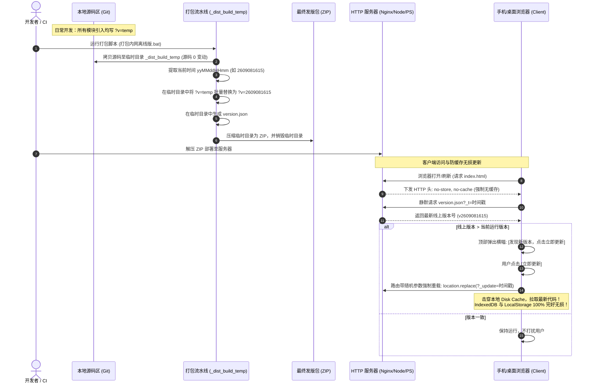

# 功能说明：版本控制与防缓存打包流水线 (Cache-Busting & Build Pipeline)

> **文档定位**：本文档沉淀了“无框架/原生 ES 模块/前后端分离单页项目”中，针对**移动端强缓存拦截**、**无损在线更新**以及**防 Git 提交历史污染**的工业级完整解决方案，可作为通用架构规范直接迁移借鉴至其他 Web 项目。

---

## 一、背景与核心痛点（Why）

在移动端和内网 Web 项目交付中，通常面临三个环环相扣的致命痛点：

```
移动端激进缓存 index.html
       ↓
发版后手机刷新依然执行旧代码
       ↓
逼迫用户去手机设置中点击“清除缓存”
       ↓
手机浏览器误将 IndexedDB / LocalStorage（网站数据）一并物理抹除！用户配置与历史对话全丢！
       ↓
为防止缓存，开发者写脚本在源码中给 JS/CSS 递增版本号
       ↓
Git 状态每次被 80+ 个文件的版本号改动严重污染，淹没真正业务提交！
```

| 痛点场景 | 根本技术原因 | 导致的破坏性后果 |
|---|---|---|
| **1. 手机端“死活不更新”** | 国内移动端浏览器（夸克、UC、微信内置、小米/华为自带等）对 HTML 的磁盘缓存（Disk Cache）极为激进，下拉刷新仅为“软刷新”（无 PC 端 `Ctrl + F5` 硬重载机制）。 | 线上/局域网发了新版，手机反复刷新依然拿着本地旧 `index.html`，后面的 JS/CSS 版本号再新也根本没机会被浏览器请求。 |
| **2. 清缓存导致数据被连带抹除** | 用户为了看新版本只能去浏览器设置里点“清除浏览数据/清除缓存”，而系统弹窗默认勾选了“Cookie 与网站数据”。 | **IndexedDB 和 LocalStorage 瞬间被物理删除**。即使调用了 W3C 的 `navigator.storage.persist()`，也无法防御用户的物理清理。 |
| **3. 传统版本号脚本污染 Git** | 传统做法是在项目源码中直接用正则把所有 `.js` 替换成当次版本号（如 `?v=2609081430`）。 | 每次打包发版，Git 工作区就会冒出几十甚至上百个文件的 diff（仅仅变了一个版本号 query），导致团队审查代码时无法看清真正的业务逻辑改动。 |

---

## 二、核心架构设计哲学（Design Principles）

为彻底斩断上述恶性循环，本架构制定了四大核心原则：

### 原则 1：源码区零污染（Source Zero-Pollution）
- **开发源码中统一固定写死占位符 `?v=temp`**。
- 严禁在日常开发中或由脚本在源码工作区硬编码具体的发版时间戳版本号。
- **效果**：无论发版多少次，Git 提交历史永远干干净净，0 版本号无意义 diff。

### 原则 2：构建区动态沙盒注入（Build-time Dynamic Injection）
- 打包脚本启动时，先将纯净源码拷贝到临时沙盒目录（如 `_dist_build_temp`）。
- **仅在临时沙盒目录中**，执行全局正则扫描，将所有 `?v=temp` 统一替换为当前 24 小时制年月日时分真实版本号（`yyMMddHHmm`），并生成版本描述文件 `version.json`。
- 压缩为 ZIP 后立即物理销毁临时目录。
- **效果**：打出来的产物 100% 带最新唯一版本号，而开发者的本地源码文件完好无损。

### 原则 3：入口指挥官永不缓存，部队强缓存秒开（Commander Pattern）
- **`index.html` 作为“指挥官”（体积仅约 30KB）**：必须严苛禁止任何中间代理和浏览器写入本地磁盘缓存（`Cache-Control: no-cache, no-store, must-revalidate, max-age=0`）。
- **JS / CSS / 图片作为“部队”（体积几 MB 到几十 MB）**：带有打包注入的版本号 query（`?v=yyMMddHHmm`），只要版本号不变，浏览器直接从 Disk Cache 中 0ms 瞬间秒读，保证首屏秒开。
- **效果**：每次打开网页只消耗几毫秒向服务器要一张最新的 30KB“兵力清单”，一旦清单中的版本号变动，浏览器才会按需精准下载变动文件。

### 原则 4：客户端静默检测与无损穿透强刷（Cache-Busting Reload）
- 前端常驻版本检测模块（`version-checker.js`），在页面启动及后台切回前台（`visibilitychange`）时，带时间戳静默拉取 `version.json`。
- 发现线上版本高于本地时，轻量横幅提示“发现新版本，[立即更新]”。
- 用户点击更新时，通过 `location.replace(url + '?_update=' + Date.now())` 强制替换路由，100% 击穿手机本地 HTTP 缓存，**秒级载入新代码，且绝不触碰本地 IndexedDB/LocalStorage，实现零数据丢失更新**。

---

## 三、系统全流程时序图



---

## 四、具体实现细节与关键代码

### 1. 源码占位符规范（写入规范文档 / ESLint / AGENTS.md）
在源码的任何位置引入内部依赖时，一律遵循 `?v=temp`：
```html
<!-- HTML 中引入 CSS -->
<link rel="stylesheet" href="css/chat.css?v=temp">

<!-- HTML 中动态引入模块 -->
<script type="module">
    import { initialize } from './js/main.js?v=temp';
</script>

<!-- HTML 中动态 fetch 模板 -->
fetch('sidebar.html?v=temp')
```
```javascript
// JS 原生 ES 模块中静态 import
import { notify } from '../ui-updater.js?v=temp';

// JS 中动态 import
const { initMCP } = await import('./mcp.js?v=temp');
```

---

### 2. 构建沙盒全量正则替换引擎（PowerShell 实现参考）
此脚本放置于 `发布打包工具/release.ps1`，支持 `-TargetDir` 定向操作临时目录：

```powershell
param(
    [string]$TargetDir = "",       # 目标目录（传入临时构建沙盒路径）
    [string]$NewVersion = "",      # 版本号（默认自动取 24 小时制 yyMMddHHmm）
    [switch]$Force                 # 静默模式，免人工回车确认
)

$targetPath = if ([string]::IsNullOrWhiteSpace($TargetDir)) { $projectRoot } else { (Resolve-Path $TargetDir).Path }
if ($NewVersion -eq "") {
    $NewVersion = (Get-Date).ToString("yyMMddHHmm")
}

$utf8NoBom = New-Object System.Text.UTF8Encoding($false)

# 1. 替换 index.html 入口
$indexFile = Join-Path $targetPath "index.html"
if (Test-Path $indexFile) {
    $c = [System.IO.File]::ReadAllText($indexFile, [System.Text.Encoding]::UTF8)
    $c = [System.Text.RegularExpressions.Regex]::Replace($c, '<title>([^<]+?)\s+\(v[^)]+\)</title>', "<title>`$1 (v$NewVersion)</title>")
    $c = [System.Text.RegularExpressions.Regex]::Replace($c, '<meta name="app-version" content="[^"]*">', "<meta name=`"app-version`" content=`"$NewVersion`">")
    $c = [System.Text.RegularExpressions.Regex]::Replace($c, 'href="([^"]+?\.css)(\?v=[^"]*)?"', "href=`"`$1?v=$NewVersion`"")
    $c = [System.Text.RegularExpressions.Regex]::Replace($c, 'src="([^"]+?\.js)(\?v=[^"]*)?"', "src=`"`$1?v=$NewVersion`"")
    $c = [System.Text.RegularExpressions.Regex]::Replace($c, "(from\s+['""]\./js/main\.js)(?:\?v=[^'""]*)?(['""])", "`${1}?v=$NewVersion`${2}")
    $c = [System.Text.RegularExpressions.Regex]::Replace($c, "(fetch\(['""][^'""]+?\.html)(?:\?v=[^'""]*)?(['""]\))", "`${1}?v=$NewVersion`${2}")
    [System.IO.File]::WriteAllText($indexFile, $c, $utf8NoBom)
}

# 2. 递归扫描 js/ 目录下的所有 ES 模块依赖树
$jsDir = Join-Path $targetPath "js"
if (Test-Path $jsDir) {
    $jsFiles = Get-ChildItem -Path $jsDir -Filter "*.js" -Recurse -File
    foreach ($file in $jsFiles) {
        $filePath = $file.FullName
        $content = [System.IO.File]::ReadAllText($filePath, [System.Text.Encoding]::UTF8)
        $orig = $content

        # 静态 import/export from
        $content = [System.Text.RegularExpressions.Regex]::Replace($content, "(from\s+['""])(\.{1,2}/[^'""]+?\.js)(?:\?v=[^'""]*)?(['""])", "`${1}`${2}?v=$NewVersion`${3}")
        # 单独副作用 import
        $content = [System.Text.RegularExpressions.Regex]::Replace($content, "(import\s+['""])(\.{1,2}/[^'""]+?\.js)(?:\?v=[^'""]*)?(['""])", "`${1}`${2}?v=$NewVersion`${3}")
        # 动态 import(...)
        $content = [System.Text.RegularExpressions.Regex]::Replace($content, "(import\s*\(\s*['""])(\.{1,2}/[^'""]+?\.js)(?:\?v=[^'""]*)?(['""]\s*\))", "`${1}`${2}?v=$NewVersion`${3}")

        if ($content -ne $orig) {
            [System.IO.File]::WriteAllText($filePath, $content, $utf8NoBom)
        }
    }
}

# 3. 自动生成 version.json
$versionObj = [ordered]@{
    version   = $NewVersion
    buildTime = (Get-Date).ToString("yyyy-MM-dd HH:mm:ss")
    timestamp = [DateTimeOffset]::UtcNow.ToUnixTimeSeconds()
}
$versionJsonPath = Join-Path $targetPath "version.json"
[System.IO.File]::WriteAllText($versionJsonPath, ($versionObj | ConvertTo-Json), $utf8NoBom)
```

---

### 3. 打包流水线整合（零交互一体化）
在 `打包内外网压缩包.ps1` 中串联：
```powershell
$tempDir = Join-Path $projectRoot "_dist_build_temp"
if (Test-Path $tempDir) { Remove-Item -Recurse -Force $tempDir }
New-Item -ItemType Directory -Path $tempDir | Out-Null

# 1. 仅拷贝过滤后的纯净源码进入临时目录
Get-ChildItem -Path $projectRoot | Where-Object {
    $_.Name -notin @('.git', 'node_modules', '_dist_build_temp', '发布打包工具')
} | Copy-Item -Destination $tempDir -Recurse -Force

# 2. 动态注入版本号（操作对象仅为 $tempDir，源码区不动！）
$releaseVersion = (Get-Date).ToString("yyMMddHHmm")
& "$toolDir\release.ps1" -TargetDir $tempDir -NewVersion $releaseVersion -Force

# 3. 压缩并打包成 ZIP
[BuiltinZipPacker]::CreateZip($tempDir, $destZip, $Password)

# 4. 清理沙盒目录
Remove-Item -Recurse -Force $tempDir
```

---

### 4. HTTP 服务器防缓存配置（核心守门人）

#### (A) Nginx 配置参考：
```nginx
server {
    listen 80;
    server_name my-app.local;
    root /var/www/my-app;

    # 1. HTML 入口文件与版本文件：严禁强缓存！
    location ~* ^/(index\.html|version\.json)$ {
        add_header Cache-Control "no-cache, no-store, must-revalidate, max-age=0";
        add_header Pragma "no-cache";
        add_header Expires "0";
        try_files $uri =404;
    }

    # 2. 带 ?v= 版本号的静态资源：允许长期缓存（30天），极速秒开
    location ~* \.(js|css|png|jpg|jpeg|gif|ico|svg|woff|woff2|ttf)$ {
        expires 30d;
        add_header Cache-Control "public, max-age=2592000, immutable";
        try_files $uri =404;
    }
}
```

#### (B) 内置轻量开发服务器（PowerShell `server.ps1`）：
```powershell
$cacheHeader = if ($ext -in @('.html', '.htm') -or $cleanPath.ToLower().EndsWith('version.json')) {
    "Cache-Control: no-cache, no-store, must-revalidate, max-age=0`r`nPragma: no-cache`r`nExpires: 0`r`n"
} else {
    "Cache-Control: no-cache`r`n"
}
```

---

### 5. 前端版本检测与一键无损强刷（`version-checker.js`）

```javascript
/**
 * 执行无损在线强制更新（击穿本地缓存重载）
 * 100% 保留 IndexedDB 会话记录与 LocalStorage 配置！
 */
export async function forceUpdateApp() {
    // 1. 若浏览器支持 CacheStorage，仅清理静态网络资源缓存，严禁触碰 IndexedDB
    if ('caches' in window) {
        try {
            const keys = await caches.keys();
            await Promise.all(keys.map(k => caches.delete(k)));
        } catch (_) {}
    }

    // 2. 带随机时间戳替换当前 URL，迫使手机浏览器向服务器重新发起 index.html 请求
    const targetUrl = new URL(window.location.href);
    targetUrl.searchParams.set('_update', Date.now().toString());

    // 使用 replace 避免在手机浏览器的后退历史列表中留下冗余页面
    setTimeout(() => {
        window.location.replace(targetUrl.toString());
    }, 200);
}
```

---

### 6. 更新日志弹窗与版本自动感知机制（`changelog-manager.js`）

为解决每次产品重大更新后用户无法直观了解新功能特性的痛点，系统接入了更新日志启动自动感知与主动弹窗机制：

#### (A) 更新日志与弹窗在项目中的物理位置：
| 组成部分 | 物理文件路径与位置 | 作用与说明 |
|---|---|---|
| **弹窗 HTML 模板** | [`modals.html`](../modals.html) (`#changelog-modal`) | 包含“更新日志”与“待开发功能”双 Tab 切换结构，历史版本倒序排布。 |
| **顶部触发按钮** | [`index.html`](../index.html) (`#changelog-btn`) | 位于顶部角色选择框左侧，用户可随时点击手动重新唤起。 |
| **独立调度服务** | [`js/services/changelog-manager.js`](../js/services/changelog-manager.js) | 专职负责动态提取最新版本号、弹窗展示与已读持久化。 |
| **主启动链路挂载** | [`js/main.js`](../js/main.js) (`initialize()`) | 在应用首屏各模块加载完毕后，延时 400ms 触发感知检测。 |
| **全量 Markdown 记录** | [`更新日志.md`](../更新日志.md) | 项目根目录技术变更总档，方便开发者与外部查阅。 |

#### (B) 核心运行机制：
1. **动态版本提取 (`getLatestChangelogVersion`)**：
   直接从 DOM 中的 `#changelog-modal .changelog-version-tag` 提取排在最前的版本号（如 `v2.9.3`），彻底避免在 JS 中硬编码版本号，保持单点真理。
2. **已读状态本地持久化 (`ai-chat-last-changelog-version`)**：
   启动时读取 `localStorage.getItem('ai-chat-last-changelog-version')`。若存储值与最新版本不一致，则主动唤起弹窗，并立即原子化更新存储。
3. **同版本防打扰保障**：
   一旦该版本被记录，后续刷新或重开页面均不会再弹窗打扰；只有当开发者在 `modals.html` 顶部追加了新版本时，才会对所有用户再次弹窗一次。

---

## 五、Windows 批处理与脚本工业级防踩坑经验（必读铁律）

在 Windows 局域网或离线环境下运行脚本，存在数个极其隐蔽的系统级陷阱，本方案已全部验证并给出防御策略：

1. **禁止在文件名/路径中使用英文半角圆括号 `()`**：
   - *原因*：Windows CMD.exe 解析中，半角括号 `()` 是命令代码块保留字。如果脚本名或目录名含有 `()`，命令行会在 `(` 处被直接截断，报 `'XXX' 不是内部或外部命令`。
   - *对策*：一律使用下划线 `_`、连字符 `-` 或纯中文命名（例如 `打包内网离线版.bat`）。
2. **批处理文件 (.bat / .cmd) 换行符必须强制为 CRLF (`\r\n`)**：
   - *原因*：CMD.exe 按字节读取并严格依赖 `\r\n` 作为换行。如果 Git 或编辑器将其保存为纯 LF (`\n`)，CMD 会吞掉前导字符导致指令串行（例如把参数截断报错 `'-NoProfile' 不是内部或外部命令`）。
   - *对策*：所有 `.bat` 文件严格强制以 CRLF 保存。
3. **PowerShell 脚本 (.ps1) 必须带 UTF-8 BOM 编码**：
   - *原因*：含有中文注释或中文路径的 `.ps1` 脚本，在 Windows 7 / 10 自带的 PowerShell 5.1 环境下，默认会按系统代码页（ANSI/GBK）读取无 BOM 的 UTF-8 文件，导致中文多字节吞掉双引号 `"` 或小括号 `)`，引发灾难性语法崩溃。
   - *对策*：所有 `.ps1` 文件强制以 `UTF-8 with BOM` 保存。
4. **批处理中路径引用必须严格双引号包裹**：
   - 凡引用 `%~dp0` 或携带空格/中文路径，必须写作 `"%~dp0server.ps1"`。

---

## 六、新项目极简迁移指南（Checklist）

如果要在其他前端原生项目或离线工具中引入这套方案，只需执行以下四步：

- [ ] **第 1 步：统一占位符**  
  全局搜索替换所有资源引入，将版本后缀统一改为 `?v=temp`（如 `import './foo.js?v=temp'`）。
- [ ] **第 2 步：复制发版引擎**  
  将 `release.ps1` 和 `打包内外网压缩包.ps1` 复制到项目的构建目录下，确保支持 `-TargetDir`。
- [ ] **第 3 步：引入版本检测服务**  
  将 `version-checker.js` 引入主入口，在初始化与 `visibilitychange` 时发起比对。
- [ ] **第 4 步：配置 Web 服务器防缓存头**  
  在 Nginx / 本地服务中对 `index.html` 和 `version.json` 配置 `no-store, no-cache`。
