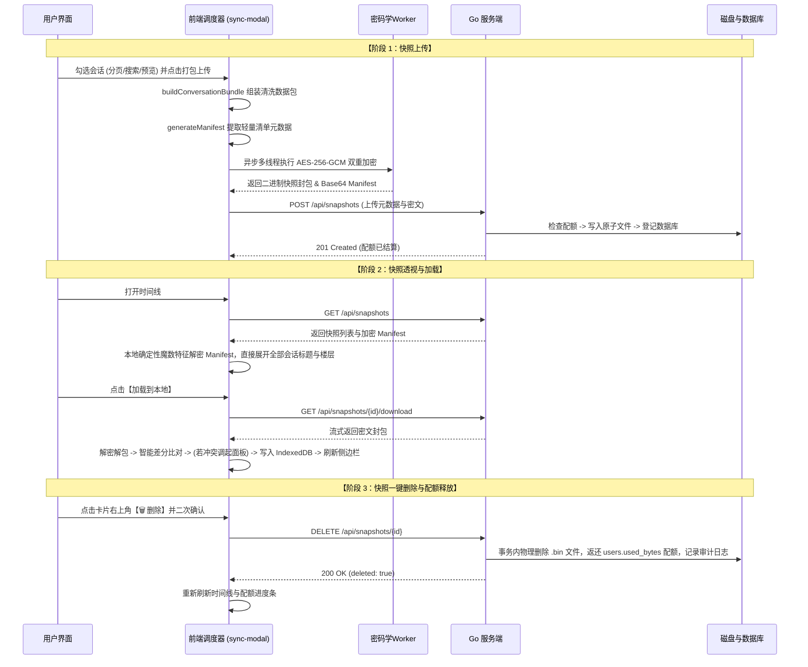

# 功能说明：跨设备会话云同步系统 (E2EE)

> **版本**：v3.5.0 (单会话极速云同步、覆盖冲突透视与回收站安全退避版)  
> **编写者**：码场老司机“小鸡”  
> **适用对象**：后续接手维护、二开与架构审查的开发人员  
> **设计原则**：本地优先 (Local-First)、零知识加密 (Zero-Knowledge)、双端无感隔离、全链路防越权

---

## 目录
1. [系统全貌与核心原则](#1-系统全貌与核心原则)
2. [端到端加密与密钥体系 (E2EE)](#2-端到端加密与密钥体系-e2ee)
3. [前端模块架构与文件职责](#3-前端模块架构与文件职责)
4. [备忘录智能差分与冲突批量决策系统](#4-备忘录智能差分与冲突批量决策系统)
5. [云端快照生命周期与配额释放闭环](#5-云端快照生命周期与配额释放闭环)
6. [服务端架构与 5 重防越权 (Anti-IDOR) 体系](#6-服务端架构与-5-重防越权-anti-idor-体系)
7. [多平台部署与运维控制台操作指南](#7-多平台部署与运维控制台操作指南)
8. [接手修改避坑指南与架构红线](#8-接手修改避坑指南与架构红线)

---

## 1. 系统全貌与核心原则

本项目长期坚持**“本地优先 (Local-First)”**与**“数据归属于用户”**的底线：

- **可选增值模块**：云同步纯属用户按需启用的可选服务。在未配置云服务地址时，应用 100% 为单机静态网页应用，不向任何第三方发起多余外联；
- **服务端零知识 (Zero-Knowledge)**：服务端仅作为带鉴权与配额的“盲盒密文仓库”。用户的明文密码与加密密钥**永不触网**，即使服务端数据库遭物理窃取，数据依然是高强度的 AES-256-GCM 密文；
- **无破坏追加导入语义**：不采用极易引发脏数据与冲突雪崩的实时双向 OT/CRDT 协同机制；设备 A 将选定会话打包加密上传为“快照”，设备 B 拉取后以带有同步标记的新会话追加至本地 IndexedDB，原本地会话完好无损。

---

## 2. 端到端加密与密钥体系 (E2EE)

参考成熟的 Bitwarden 双层密钥派生规范，用户只需输入一个主密码，即可在前端派生出分别用于**身份验证**与**数据加密**的两套独立密钥：

```
[用户主密码]
    │
    ▼
PBKDF2-SHA256 (60万轮迭代, 盐 = 服务端预登录下发的 16 字节随机 salt)
    │
    ▼
[masterKey] (32 字节，仅存在于浏览器 Worker 内存中，不落盘)
    │
    ├─► HKDF-SHA256 (info = "ruthless-sync-enc-v1") 
    │       │
    │       ▼
    │   [encKey] (32 字节 AES-256-GCM 密钥，存入独立隔离的 ruthless_sync_db 数据库)
    │
    └─► PBKDF2-SHA256 (1轮迭代, 盐 = 用户主密码)
            │
            ▼
        [authHash] (64位 Hex 字符串，提交给服务端进行身份验证)
            │
            ▼ (服务端接收后)
        Argon2id (加服务端内部独立盐哈希后安全持久化)
```

### 2.1 密文封包规范 (Format Version = 1)
所有上传到云端的会话快照与 Manifest 清单，统一封包为以下二进制格式：

```
+----------------+----------------+----------------+-------------------------------------+
|  Magic (4B)    |  Version (1B)  |    IV (12B)    |      Ciphertext + Tag (16B)         |
| 0x52 0x53 0x59 0x4E  ("RSYN")   | 0x01 (当前版本) | 安全随机数IV   |    AES-256-GCM 密文与认证标签       |
+----------------+----------------+----------------+-------------------------------------+
```

- **数据压缩**：明文在加密前执行 `gzip` 压缩，优先使用原生 `CompressionStream('gzip')`，无安全上下文或不支持时平滑降级；
- **AAD 附加认证数据**：固定构造为 `UTF8("${userId}|${snapshotId}|1")`，强制将密文与用户 ID 及快照 ID 强绑定，防止重放、篡改与跨租户搬移；
- **Manifest 清单机制**：为避免在快照时间线中为了展示名称每次都要下载几十兆的大文件，上传快照时前端提取轻量清单（会话名称、楼层数、更新时间），使用同一密钥单独加密并以 Base64 输出存储在数据库记录中。

### 2.2 魔数特征识别与解密韧性
针对 Base64 与十六进制字符集重叠的经典编码冲突，解码 Manifest 时采用**确定性魔数特征优先匹配**：
- Base64 编码的 `"RSYN"` 前缀必然为 `UlNZ`；
- Hex 编码的 `"RSYN"` 前缀必然为 `5253594e`；
- 配备双向 try-catch 魔数自动回退兜底，彻底根除因编码混淆抛错导致快照列表显示“共多会话”或白屏的缺陷。

---

## 3. 前端模块架构与文件职责

为严格遵守项目《架构师代码规范》中“控大防膨、严禁无节制堆砌业务代码”的原则，云同步模块全部采用独立文件封装：

| 文件路径 | 职责与设计原理 |
|---|---|
| `js/modals/sync-modal.js` | **Plan A 一体化状态机**调度中心。管理“未配置节点 ➔ 探测成功 ➔ 未登录 ➔ 已就绪 ➔ 更换节点”全状态流转，负责上传列表分页、搜索过滤、时间线解密透视、快照删除交互。 |
| `js/services/sync-bundle.js` | **数据清洗与组装器**。从 IndexedDB 中按需提取选中会话、绑定的备忘录、隐藏与总结配置、专属正则规则，清洗多余引用，生成轻量 Manifest 清单。 |
| `js/services/sync-crypto.js` | **密码学套件引擎**。双轨制实现：在安全上下文 (HTTPS/localhost) 优先使用原生硬件加速的 `crypto.subtle`；在内网 HTTP 环境自动平滑降级至纯 JS 的 `@noble/ciphers` 与 `@noble/hashes`，保证内网部署绝对可用。 |
| `js/services/sync-store.js` | **独立凭据数据库**。在浏览器 IndexedDB 中开辟独立的 `ruthless_sync_db` 空间，将 Token、设备名与派生后的非导出密钥独立持久化，杜绝污染业务主数据库。 |
| `js/services/sync-client.js` | **HTTP 客户端服务**。统一包装请求超时、熔断机制、自动注入 `Authorization: Bearer <token>`、统一处理 401/403/429 异常。 |
| `js/workers/sync-kdf.worker.js` | **密钥派生后台线程**。将 60 万次耗时的 PBKDF2 与 HKDF 运算移至 Web Worker 执行，优先使用原生 WebCrypto 硬件加速（从 1.5s 降至 50ms），内网平滑回退 noble-hashes，异常强力阻断。 |
| `css/sync.css` | **样式表**。全量适配浅色与深色主题（`body[data-theme="dark"]`），严禁使用纯白硬编码；配备 `@media (max-width: 640px)` 移动端流式自适应断点与旋转微交互动画。 |
| `js/services/trash-manager.js` | **会话回收站管理中心**。负责常规软删除、批量移入、一键恢复、物理彻底删除、清空回收站，以及 10 天自动衰期物理销毁与覆盖前自动备份。 |
| `js/modals/sync-conflict-modal.js` | **会话覆盖冲突决策弹窗**。比对本地现有版本与待导入/云端版本的消息总数、修改时间与最后 2 条消息透视，支持「覆盖本地」、「保留两者」、「跳过」三大策略。 |
| `css/trash.css` | **回收站与冲突对比样式表**。全量适配浅色与深色主题，支持侧边栏回收站列表、倒计时剩余天数微标与双列响应式冲突对比卡片。 |

---

## 4. 智能差分与冲突对比决策保护体系 (备忘录+会话)

### 4.1 智能差分比对算法 (`isWorldBookContentIdentical`)
当加载快照或导入包含备忘录的会话时，系统不搞暴力覆盖或盲目弹窗：
- **排除运行时字段**：严格排除 `sessionIds`（运行时关联的会话列表，各端进度不同必然不同）；
- **实质内容 100% 一致**：包括名称、正文、位置、深度、生效状态、关键词、标签全等时，直接**静默通过，绝不打扰用户**；
- **存在实质差异**：自动搜集冲突项，唤起批量冲突决策面板。

### 4.2 全量字段透视与实质差异高亮 (`import-conflict-modal.js`)
对比面板采用桌面端 880px 宽屏 / 移动端 95vw 两层纵向响应式堆叠：
- **8 大全量字段透视**：条目名称、生效状态（✅/❌）、注入位置、挂载深度、生效角色、关键词、分类标签，以及**带滚动框的完整正文（绝不截断到 80 字）**；
- **实质差异行自动高亮**：凡存在差异的字段行自动施加浅橙色背景与 `⚠️ 差异徽章`；
- **【都保留】感叹号悬浮说明**：在批量与条目【都保留】旁嵌入精致的圆形感叹号徽章 `!`，鼠标悬浮或点击弹出策略说明气泡，明确提示“原条目不破坏，新建 `(同步副本)` 并重定向会话”。

### 4.3 「都保留」副本生成与新会话自动映射重定向机制
在 `js/utils.js` 中的 `importConversations()`：
```javascript
// 当用户对冲突备忘录选择「都保留 (keep_both)」时：
// 1. 本地原条目保持原汁原味，不作任何修改；
// 2. 生成全新 ID 的副本条目：wb_sync_xxx，名称后缀增加 (同步副本)；
// 3. 在 wbIdRedirectMap 记录映射：wbId -> copyId；
// 4. 遍历数据包时，新导入的会话经由 wbIdRedirectMap 重定向，精准绑定至新副本 sessionIds；原备忘录绝不受污染！
```

### 4.4 全入口公共导入收口
无论是从【云同步 → 加载到本地】还是从【系统设置 → 数据管理 → 导入会话记录】执行导入，底层 100% 收口于 `importConversations()`，并将 `renderHistory()` 侧边栏刷新下沉至函数底层执行，确保任意入口导入后左侧列表均实时无感刷新。

---


### 4.5 会话覆盖冲突透视与回收站安全退避体系 (`sync-conflict-modal.js` + `trash-manager.js`)

#### 1. 为什么需要覆盖冲突保护？
当用户在不同设备上独立推进同一会话，拉取快照或导入会话记录时，直接强制覆盖会导致本地新增的聊天记录瞬间蒸发；而无脑重命名为副本又会导致侧边栏充满大量重复条目。因此必须建立**“透视对比 + 决策选择 + 回收站安全退避”**的完整闭环。

#### 2. 全要素深度对比透视
- **消息楼层数比对**：若两端楼层数不一致，以黄色高亮徽章标明（例如 `消息数量不同 (本地 8 vs 待导入 12)`）；
- **时间与新旧标注**：精确计算两端会话的最后修改时间戳，为更新的一侧打上绿色 `较新` 徽章；
- **最后 2 条消息真实正文透视**：提取两端活动分支的最后 2 条消息，展示楼层号、角色标签（用户/AI/系统）、发言时间及纯文本正文摘要，时序进展一目了然。

#### 3. 三大决策处理策略
1. **覆盖本地会话（旧版入回收站）**：
   - 待导入版本作为最新版替换本地对应 ID 的会话；
   - **关键安全保护**：原本地版本绝不物理销毁，而是由 `trashManager.moveToTrash(localConv, { isBackup: true })` 自动克隆一份完整备份保存于【回收站】中，附带 `(覆盖前备份)` 标题与 10 天保留期，后悔随时可恢复！
2. **保留两者（创建同步副本）**：
   - 本地原会话保持原汁原味；
   - 待导入版本分配全新 ID，并自动追加 `(同步副本)` 后缀；
3. **跳过此会话**：
   - 放弃导入该冲突项，本地维持现状。

#### 4. 10 天自动衰期会话回收站机制
- **软删除标记**：已删除会话打上 `isDeleted: true` 与 `deletedAt: Date.now()` 标记；
- **全链路物理隔离**：常规侧边栏列表（简略/分组）、全文搜索、批量管理以及会话导出（`buildConversationBundle` / `exportAllConversations`）100% 过滤排除软删除会话，彻底杜绝废弃数据污染备份；
- **10 天自动物理清理**：应用启动（`main.js`）与进入回收站时自动扫描，彻底抹除删除时间超过 10 天（`Date.now() - deletedAt > 10 * 24 * 3600 * 1000`）的过期会话，自动释放存储空间。

---

## 5. 云端快照生命周期、单会话极速同步与配额释放闭环



### 5.4 移动端弱网大文件断流根治与 HTTP Range 分片并发架构 (v3.2.0 新增)

跨国 VPS（如韩国专线）环境下，PC 端往往由于低丢包率可秒级完成 5MB+ 快照下载；而移动蜂窝网络（4G/5G）常存在路径 MTU 抖动、中间代理流控与 TCP RST 重置。

#### 1. 为什么不能改成 POST？
- **RFC 7233 协议铁律**：HTTP 范围请求规范明确规定 `Range: bytes=start-end` 与 `206 Partial Content` **仅在 GET 请求下有效**。改用 POST 会直接丧失所有断点续传与浏览器原生切片能力；
- **传输层解耦**：TCP 层的连接重置无差别影响 GET 与 POST，单流无论请求方法如何都会被掐断。

#### 2. Plan A 双路并发流式加速与断点容错架构
- **1.5MB 弹性分片步长**：前端 `sync-client.js` 以 `1,572,864 字节 (1.5MB)` 为步长发起 `Range: bytes=0-1572863` 首片探测，探知切片支持度与总包体大小；
- **双路并发管道池 (2-Way Parallel Pipeline)**：
  探知总包长后，同时启动 2 路并发 Worker 管道拉取后续分片，消灭跨国高延迟（RTT 60~90ms）下的单路串行停顿，彻底跑满服务器带宽上限；
- **片内细粒度流式推进 (ReadableStream 字节心跳)**：
  每个分片采用底层 `ReadableStream reader` 流式读取，每接收 16~64KB 数据即刻触发心跳刷新，彻底消除原先 1MB/2MB 间的界面假死卡顿；
- **动态滑动窗口测速器 (SpeedTracker)**：
  内置 2 秒滑动时间窗口平滑滤波器，实时计算精确网速（MB/s / KB/s）与动态倒计时（ETA 秒），界面实时呈现：`正在下载密文数据包 (2.1 / 5.3 MB · 40% · 185 KB/s · 剩余 17秒)...`；
- **分片局部自愈与容错回滚（30秒超时与最多3次退避重试）**：
  每个分片独立设置 30 秒超时熔断器。弱网抖动仅会局部重传当前分片，并在重试前精确回滚计数器，杜绝进度跳变与全盘重拉；
- **老服务端零破坏向下兼容**：
  若老版本服务端或反代网关不支持切片（返回 `200 OK`），无缝降级为全量流式接收；
- **服务端 http.ServeContent 零拷贝支持**：
  服务端采用 Go 标准库 `http.ServeContent` 替代脆弱单向 `io.Copy`，自动支持 RFC 7233 Range 规范，并在 `http.Server` 中将 `WriteTimeout` 置为 0（不限大文件写流时长），彻底根除服务端主动斩断长连接的问题。

---


### 5.5 单会话极速云同步与快照单会话按需加载 (Quick Cloud Sync & Granular Apply)

#### 1. 单会话极速云同步 (`syncSingleConversation`)
- **操作入口**：在左侧侧边栏每个会话悬停操作区（带有 Lucide 矢量云朵图标）以及移动端长按 Action Sheet 菜单中提供直接入口；
- **秒级自动流转**：一键打包当前单会话及其专属关联数据（专属备忘录与专属正则），由 Web Worker 进行端到端 AES-256-GCM 双重加密后极速推送至云端；
- **避免全量繁琐操作**：无需打开云同步大弹窗、无需手动翻页筛选勾选，一键直达。

#### 2. 快照时间线单会话按需加载
- **轻量清单按需呈现**：云端快照卡片展开后，不仅能看清所有包含会话的标题、楼层数与实时模式标记，每个会话行右侧配备【仅加载此会话】按钮；
- **局部拉取与智能冲突防御**：点击后仅将选定的单条会话还原至本地，若存在内容差异自动唤起冲突对比面板，安全可控。

### 5.6 跨快照批量清理与主密码二次验密体系 (v3.6.0 新增)
为解决云端快照积累导致的配额消耗与逐个点击删除的繁琐痛点，引入批量清理与密码二次鉴权闭环：
- **批量管理状态机**：点击【批量管理】唤起操作浮动工具栏，所有快照卡片与历史版本行左侧动态浮现复选框，支持【全选】、【清空已选】与实时计算选中项体积（MB）；
- **主密码二次安全验密**：批量清理属于不可逆的高危物理销毁操作。前端要求输入云同步主密码，由 Web Worker 调用 PBKDF2(SHA-256) 快速派生出 `authHashHex`（约 50ms 硬件加速），随请求提交至服务端；
- **服务端原子清理 (`POST /api/snapshots/batch-delete`)**：
  1. 服务端对提交的 `authHash` 结合服务端盐执行 `Argon2id` 校验，输错计入失败计数，连续失败 3/5/10 次自动触发锁定期（防爆破防撞库）；
  2. 验证通过后，在单一 SQLite 微事务中执行 `SELECT SUM(size) ... WHERE user_id = ? AND id IN (...)` 精准汇总配额，执行批量删除并原子扣减 `users.used_bytes`；
  3. 事务提交后物理删除磁盘对应 `.bin` 密文文件，记录审计流水，杜绝中途断网导致的脏数据与配额不一致。

---

## 6. 服务端架构与 5 重防越权 (Anti-IDOR) 体系

服务端采用原生 Go 语言编写，位于 `sync-server/` 目录，单二进制文件无第三方重型依赖。为确保多用户环境下快照数据绝不被篡改或误删，服务端设立了 **5 重防越权铁闸**：

1. **第一重：身份不可伪造 (Token 反查)**  
   用户的身份标识 `userID` 绝不相信前端 URL、Query 或 Body 传入的值，而是由鉴权中间件根据 `Authorization: Bearer <token>` 计算哈希后，直接反查数据库 `devices` 表提取；
2. **第二重：核心 SQL 双字段强绑定**  
   快照查询、下载、删除的每一句 SQL，必须强制包含 `WHERE id = ? AND user_id = ?`。若攻击者传入别人的快照 ID，查询结果永远为 0 行，服务端直接返回 404，别人的快照纹丝不动；
3. **第三重：物理磁盘沙盒硬隔离**  
   每个用户的密文封包严格存放在各自的独立文件夹中：`filepath.Join(dataDir, userID, snapshotID+".bin")`，从文件系统底层隔离；
4. **第四重：存储配额独立结算与全服总上限熔断**  
   - **个人配额结算**：每个用户默认配额 200MB（209,715,200 字节）。上传前原子检查：`used_bytes + newSize <= max_bytes`；删除快照时，仅返还给操作者本人的 `users` 记录：`UPDATE users SET used_bytes = MAX(0, used_bytes - ?) WHERE id = ?`；
   - **全服最大总空间熔断 (`maxTotalStorageBytes`)**：默认全服上限 1GB（1,073,741,824 字节，支持动态热重载与 0 不限制）。上传时在无事务阶段执行 Fast-Fail 预检，在毫秒级 SQLite 微事务中执行并发二次原子确认（`SUM(size) + written <= maxTotalStorageBytes`），超额时返回 HTTP 507 `SERVER_STORAGE_FULL` 拒绝新上传，彻底杜绝磁盘打爆与并发超卖；
5. **第五重：不可篡改的安全审计流水**  
   每一次登录、上传、下载、删除快照，系统自动将操作人 ID、设备 ID、操作类型、客户端真实 IP 与时间戳写入 `audit_logs` 表，支持运维追溯。

### 6.6 AI 接口后台任务中转系统 (AI Task Relay)
为解决移动端手机切后台、断网抖动或切换 Wi-Fi 导致大模型长回复全盘作废的痛点，`sync-server` 扩展了标准 CatieCli 兼容的异步任务中转服务：
- **请求任务化 (`POST /v1/openai/tasks`)**：客户端发起请求秒回 `task_id`，服务端在后台接力调用上游大模型；
- **断网自愈与轮询 (`GET /v1/openai/tasks/{id}`)**：网络恢复后随时凭 ID 查取完整生成成果；
- **配置化数据留存与裁剪**：默认保留 24 小时，最多保留 500 个请求（支持 `config.json` 动态热重载）；
- **默认非流式安全直达**：开启后默认以非流式转向上游，杜绝长时间挂起占用；
- **详细专属设计文档**：请参见 [`功能说明-AI接口后台任务中转.md`](./功能说明-AI接口后台任务中转.md)。

---

## 7. 多平台部署与运维控制台操作指南

### 7.1 服务端编译
在 `sync-server/` 目录下执行编译脚本即可一次性输出全平台架构二进制包：
- **Windows**: `build.ps1` ➔ 生成 `bin/sync-server-windows-amd64.exe`
- **Linux**: `build.sh` ➔ 生成 `bin/sync-server-linux-amd64` 与 `bin/sync-server-linux-arm64`

### 7.2 根目录一键脚本体系 (已做防 CMD 截断与 CRLF 规范)
| 脚本名称 | 适用场景 |
|---|---|
| `启动同步服务.bat` | Windows 下直接一键启动 Go 同步后端，开箱即用。 |
| `生成邀请码.bat` | 快速签发一个明文注册邀请码（默认有效期 7 天）。 |
| `查看邀请码列表.bat` | 查看所有邀请码的创建时间、有效期与已绑定使用者。 |
| `数据看板.bat` | 启动交互式管理控制台，管理用户账号、调整配额、清空或注销用户。 |
| `打包多平台包.bat` | 自动交叉编译 Windows / Linux 多架构服务端并打包为发布压缩包。 |

### 7.3 交互式控制台菜单命令 (`sync-server.exe console`)
运行控制台后输入数字序号即可执行对应的管理指令：
- `1. 签发注册邀请码`：指定有效期（天）与可绑定用户上限；
- `2. 查看邀请码列表`：查看使用状态与绑定的具体账户名；
- `3. 用户数据综合看板`：列出所有用户、关联邀请码、备注、已存快照数、存储占用字节数、封禁状态；
- `4. 管理员直接创建新用户`：无需前端邀请码，后台直建账号与默认配额；
- `5. 修改用户存储配额`：调整指定账号的最大可用容量；
- `6. 修改用户备注信息`：为用户添加易于识别的备注名；
- `7. 冻结 / 解冻用户账号`：封禁恶意账号或重置登录失败锁定状态；
- `8. 重置用户主密码认证哈希`：帮助用户重设鉴权哈希；
- `9. 清空用户所有快照数据`：物理销毁某用户的所有云端文件并清零配额；
- `10. 彻底注销并删除用户`：级联物理删除用户的所有设备、快照与账户。

---

## 8. 接手修改避坑指南与架构红线

后续开发人员在修改云同步或相关界面时，**必须严格遵守以下红线原则**，避免踩坑：

1. **版本号规范（防 Git 污染铁律）**：
   - 源码中的所有 JS/CSS 引入一律保持 `?v=temp`（如 `import { foo } from './bar.js?v=temp'`）；
   - **严禁**在源码文件中硬编码诸如 `?v=2611032230` 的真实时间戳，发版时间戳统一由打包流水线在临时构建目录动态注入。
2. **主题色双模适配（UI 铁律）**：
   - 任何新增的按钮、卡片、弹窗或提示框，必须同时编写浅色与深色（`body[data-theme="dark"]`）样式；
   - **严禁**使用未适配暗色主题的纯白 (`#ffffff`) 背景，必须使用 CSS 变量（如 `var(--bg-surface)`）或在暗色主题下编写高对比度背景与文本。
3. **Windows 批处理规范（防字符解析崩溃）**：
   - 批处理文件 (`.bat` / `.cmd`) 的换行符必须强制为 **CRLF (`\r\n`)**，禁止使用 LF；
   - 禁止在文件名或脚本路径中使用英文半角括号 `()`（CMD 会在括号处误判代码块截断报错）。
4. **正则表达式管理**：
   - 新增的正则表达式必须统一集中在 `js/regex.js` 中定义，使用反引号包裹，禁止散落在业务文件中裸写。
5. **XSS 与 HTML 实体转义**：
   - 渲染会话标题、设备名、快照名称时，必须统一通过 `escapeHtml()` 转义，严禁直接拼接未经清洗的 innerHTML。
6. **废弃方法清理**：
   - 废弃或重命名任何公共工具方法时，必须全局搜索并清理所有旧引用，绝不允许留下悬空报错。
7. **统一矢量图标（UI 视觉铁律）**：
   - 必须严格遵守根目录下《图标使用指南.md》，使用标准 Lucide/Feather 风格（`viewBox="0 0 24 24"`、`stroke="currentColor"`），严禁在界面与按钮中使用硬编码 Emoji 或 Windows 98 级别的 ASCII 三角字符。
8. **交互防呆与配额安全**：
   - 备份会话列表默认全都不选，避免意外勾选超大数量打爆云端存储配额；
   - 注册提交必须配备红色高亮安全警示卡片与【一键复制账号与密码】功能，强制勾选确认后才允许提交，杜绝用户遗忘主密码导致云端数据永久变砖。
